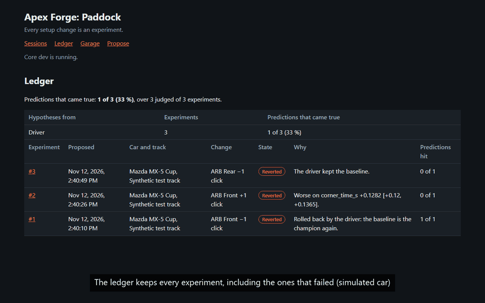
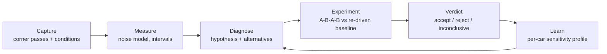
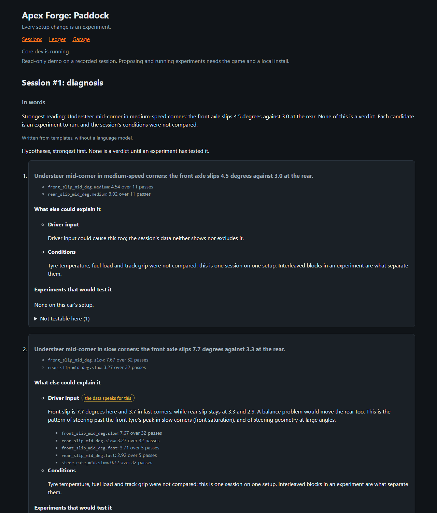
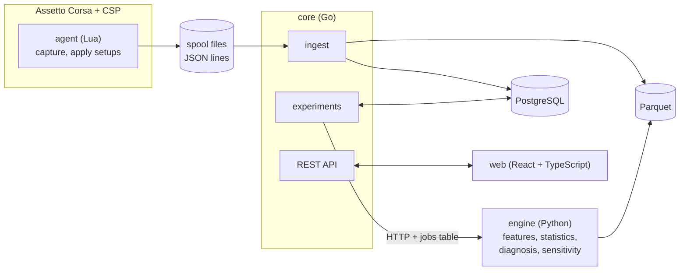

# Apex Forge: Paddock

[](https://github.com/JassV9/Apex-Forge-Paddock/actions/workflows/ci.yml)

**A vehicle engineering lab for Assetto Corsa that treats every setup change as an experiment,
and can prove when it is wrong.**

My first setup-advice app made my car slower. It told me, confidently, that each change was an
improvement. When I audited it against my own driving data, I found that its verdict logic
called two *identical* setups a regression **39% of the time**. Paddock is the rebuild: a
local-first platform (Go, Python, PostgreSQL, React, and a Lua agent inside the game) where a
recommendation is a hypothesis with a prediction, tested against a re-driven baseline, with the
result recorded even when it fails.

> **Status: capture verified in Assetto Corsa; experiments not yet driven.** Capture, ingest, the
> measurement statistics, experiments, diagnosis, the sensitivity profile and a read-only
> demo work and are tested (phases 0 to 5 and 7; phase 6 is optional research). The
> [roadmap](#roadmap) below says exactly what exists today. The agent has recorded one
> real practice session in the game (102 corner passes, none rejected); no experiment
> has been driven there, and the demo is not deployed.



*Three experiments on a simulated car, driven by the end-to-end test: the real Lua agent,
Go service and Python engine, with a mocked game. Not Assetto Corsa.*

## The finding that started this

The prototype, Apex Forge v0.3, recorded how I drove each corner and suggested the next setup
version. Over nine versions at COTA the car got worse, and I went back to the baseline. The
audit ([docs/audit-v0.md](docs/audit-v0.md)) found three causes:

| What went wrong | Evidence |
| --- | --- |
| **The verdict logic fired on noise.** | My corner times scatter by 28 ms. Simulating the app's exact rules on that scatter, two identical setups are judged "slower" in 39% of comparisons. |
| **The diagnosis measured the driver, not the car.** | "Understeer" read +4.2° below 100 km/h and +0.7° above 150 km/h, with rear slip flat. Eight versions of anti-roll bar and brake bias changes barely moved it. It was most likely me steering past the front tyre's peak in hairpins. |
| **Nothing was compared under comparable conditions.** | Versions were driven one after another, never against a re-driven baseline, with no record of fuel, tyre temperature or track evolution. |

You can reproduce the first one in ten seconds, with nothing but Python:

```console
$ python tools/verdict_noise_sim.py
n=3: identical setups flagged slowerWins 39%
n=5: identical setups flagged slowerWins 33%
n=8: identical setups flagged slowerWins 26%
```

Tuning thresholds cannot fix that. The method had to change. The whole story, with what
each finding became and where it is tested, is the
[case study](docs/case-study-v0-regressions.md).

## What Paddock does instead



- **Every change is an experiment.** One knob, a predicted effect, a success test fixed before
  driving, interleaved A-B-A-B blocks, and the minimum effect the plan can detect shown up
  front.
- **Noise is measured, not assumed.** A mixed model over all corners gives one effect estimate
  with an interval, instead of 17 separate per-corner comparisons.
- **Ties go to the baseline.** Inconclusive means revert. Failed experiments stay in the ledger.
- **Driver or car?** Diagnosis must consider "driver input" as an alternative explanation
  before blaming the setup.
- **The LLM explains, it never decides.** It receives computed metrics and must cite them; a
  reply that invents a number is rejected. The system runs fully without one.
- **It scores itself.** Every prediction is checked against its result, so "how often is this
  tool right?" becomes a number.

On the session that started all this, the diagnosis now says what v0 never could: the
understeer is real, and the driver's steering explains it as well as the car does.



*The read-only demo on the real recorded session (`make demo-replica`).*

## Architecture

A local-first modular monolith: three processes and one database on one PC, plus a thin agent
in the game. Details in [docs/architecture.md](docs/architecture.md).



| Layer | Choice | Why |
| --- | --- | --- |
| In-game agent | CSP Lua, writes spool files | Zero risk on the game thread; crash-safe ([ADR 0003](docs/adr/0003-spool-transport.md)) |
| Backend | Go, one binary | Ingest, state machine and API in one deployable ([ADR 0001](docs/adr/0001-modular-monolith.md)) |
| Analysis | Python (pydantic, statsmodels, DuckDB) | Where the statistics ecosystem lives |
| Storage | PostgreSQL + Parquet | Relational ledger, columnar raw samples ([ADR 0004](docs/adr/0004-postgres-and-parquet.md)) |
| Dashboard | React, Vite, TypeScript | A local app does not need server rendering ([ADR 0005](docs/adr/0005-react-and-vite-not-nextjs.md)) |
| Shared types | JSON Schema, code-generated for Go, Python and TypeScript | One source of truth; CI fails on drift |

**What I chose not to build**, and when each would be justified, is written down too: no
Kafka, no Kubernetes, no microservices
([ADR 0006](docs/adr/0006-no-kafka-no-kubernetes.md)). One user on one PC does not need them,
and a Postgres `jobs` table with `SKIP LOCKED` does the queueing.

## Roadmap

| Phase | Scope | State |
| --- | --- | --- |
| 0 | Skeleton: layout, contracts + codegen, CI, Compose, ADRs, reused v0 capture code under test | **Done** |
| 1 | Capture and ingest: agent emits corner passes with conditions; spool to Parquet and Postgres | **Done** (verified in game on one session, one car, one track) |
| 2 | Measurement: features, noise model, mixed model, minimum detectable effect | **Done** (simulated: false decisions 39% to 0%) |
| 3 | Experiments: state machine, A-B-A-B run plans, blind code-named setups, verdict ledger, rollback | **Done** (end to end on a simulated car; unverified in game) |
| 4 | Diagnosis and explanation: hypotheses with evidence, driver-vs-car separation, schema-bound LLM | **Done** (on the real COTA session; hosted models unverified) |
| 5 | Sensitivity profile and experiment ranking: pooled effects with intervals, flagged priors, expected gain per lap | **Done** (on a simulated car; the 20+ experiment optimizer is not built) |
| 6 | Ghost Driver (research, optional): machine-driven test manoeuvres | Gated |
| 7 | Public read-only demo on recorded data, case study | **Done locally** (read-only door tested in CI; Terraform for Azure validated, **never applied**) |

Each phase has written acceptance criteria ([docs/MASTER_PROMPT.md](docs/MASTER_PROMPT.md),
section 5) and ends with a demo script in [docs/demos/](docs/demos/).

**In the repository today:**

- An in-game agent (Lua) that records every corner pass with its conditions: fuel, tyre
  temperatures, pressures, wear, track grip, and 24 raw channels at up to 60 Hz (45 Hz in the first real
  session, the game's frame rate). It costs about
  0.002 ms per frame in the mocked benchmark and drops any pass interrupted by a restart,
  teleport, pit visit or replay.
- A Go service that tails the agent's spool, validates every line against a JSON Schema,
  writes raw samples to Parquet and passes to PostgreSQL idempotently, and exposes
  Prometheus metrics.
- The session that started this project, replayable by anyone: `make demo` ingests the real
  FA26 COTA log (136 passes, 17 corners) and lists it in the dashboard.
- A measurement engine (Python) that estimates a setup's effect across all corners at once,
  with a calibrated interval. On simulated experiments with my real scatter, identical setups
  produce a decision in 0% of 200 runs (v0: 39%), and a 20 ms per corner effect is detected
  in 91.5% ([how, and what was rejected](docs/adr/0008-effect-model.md)).
- The audit's finding as a test: on the real session, front slip is 7.7° in slow corners and
  3.7° in fast ones while rear slip stays near 3°.
- Experiments from proposal to verdict: a state machine in Go where every move is one
  transaction with a logged reason, interleaved A-B-A-B blocks under random code names so the
  driver does not know which setup is the baseline, automatic revert of anything that is not
  clearly better, and a re-check of the current setup against the original after three
  accepted changes ([the rules](docs/adr/0009-experiments.md)).
- An end-to-end test that runs the real Lua agent, the Go service and the Python engine
  through three experiments on a simulated car (`make test-e2e`). It caught a design error
  that every unit test had passed: after a rejected experiment, the next one would have
  started from the rejected setup ([demo script](docs/demos/phase-3.md)).
- A diagnosis that asks the question v0 never did. On the session that started this,
  it reads "understeer in slow corners" and, beside it, that the driver's steering
  explains it as well as the car does, with the numbers that say so. Its output is a
  list of experiments to run, never a fix to apply
  ([ADR 0010](docs/adr/0010-diagnosis-and-explain.md), [demo script](docs/demos/phase-4.md)).
- A memory of what each setup item does. Finished experiments are pooled into a
  per-car profile with intervals; a simulated car's linear, negligible and non-linear
  items are recovered. A number borrowed from a similar car is shrunk, widened and
  always shown as a prior. The next experiment is ranked by expected gain per lap, and
  a change the car already showed to do nothing is left out with the reason
  ([ADR 0011](docs/adr/0011-sensitivity-and-ranking.md), [demo script](docs/demos/phase-5.md)).
- A language model behind a gate. It gets the computed evidence and may only put it
  into words: a reply that cites a metric the session never measured, or states a
  number that is not in the evidence, is thrown away and template text is shown.
  Everything works with no model and no API key.
- A dashboard with a ledger of every experiment and, per experiment, the test that was fixed
  before driving, the effect of each channel with its interval, and its full history;
  per session, the diagnosis with its evidence, alternatives and what to test next;
  a garage of measured effects; and a scorecard of predictions that came true.
- One contract for all of it: the same schema files generate the Go, Python and TypeScript
  types and validate what the Lua agent writes. CI fails on drift.
- A demo that can go on the internet without becoming writable. nginx lets only reads
  through, so the rule holds for every route, including ones written later; core has no
  demo mode to drift. It is one disposable replica that keeps nothing, described in
  Terraform for Azure Container Apps and rehearsed in Compose. CI starts that replica on
  every push and checks that reads answer and writes get a 403
  ([ADR 0012](docs/adr/0012-read-only-demo.md), [runbook](docs/runbooks/deploy-demo.md)).
  **It has not been deployed**: no cloud account is used from this repository.

Capture has run inside Assetto Corsa once; experiments have not, and the docs say so wherever
it matters ([first-run results and checklist](docs/runbooks/agent-in-game.md)).

## Run it

Needs Go 1.27+, [uv](https://docs.astral.sh/uv/), Node 24+ and GNU make. No game required.
Full walkthrough: [docs/onboarding.md](docs/onboarding.md).

```bash
make setup   # install dependencies for every module
make test    # Lua (under LuaJIT), Go, Python, TypeScript
make test-e2e  # three experiments through agent, core and engine (needs PostgreSQL)
make lint    # golangci-lint, ruff, mypy --strict, eslint, prettier
make gen     # regenerate Go, Python and TypeScript types from contracts/
make demo    # full stack in Docker on a recorded session, http://localhost:5173
make demo-replica  # the read-only public demo, laid out as it would run on Azure
make dev     # the same stack, ingesting what the in-game agent writes
```

## Repository tour

| Path | Contents |
| --- | --- |
| [`contracts/`](contracts/) | JSON Schema for every type that crosses a process boundary |
| [`core/`](core/) | Go monolith: ingest, setups, experiments, API, store and migrations |
| [`engine/`](engine/) | Python analysis engine |
| [`web/`](web/) | React dashboard |
| [`agent/`](agent/) | CSP Lua agent, mock CSP API, and offline tests on real fixtures |
| [`datasets/demo/`](datasets/demo/) | The real v0 session as a replayable spool |
| [`deploy/`](deploy/) | Compose files: development, demo, and the read-only replica with its smoke test |
| [`infra/azure/`](infra/azure/) | Terraform for the public demo (validated, never applied) |
| [`docs/`](docs/) | [Architecture](docs/architecture.md), [design](docs/design.md), [v0 audit](docs/audit-v0.md), [case study](docs/case-study-v0-regressions.md), [ADRs](docs/adr/), [API](docs/api/openapi.yaml), [onboarding](docs/onboarding.md) |
| [`tools/`](tools/) | Scripts, including the verdict-noise simulation above |

## How it is built

- **Spec first.** The design document and the phase plan were written before any code. Each
  phase has acceptance criteria that are tests, not opinions.
- **Decisions are recorded.** Anything that would surprise a new engineer gets an ADR,
  including the things deliberately left out.
- **Verified, or labelled unverified.** Every change reports how it was checked and what was
  not. "Works in game" is never claimed without running it in the game.
- **Built with an AI pair.** I develop this with Claude Code, working from the brief in
  [docs/MASTER_PROMPT.md](docs/MASTER_PROMPT.md) and the conventions in
  [CLAUDE.md](CLAUDE.md). Both are in the repository, so the process is as inspectable as the
  code.

---

Not affiliated with Kunos Simulazioni or the Custom Shaders Patch team. Assetto Corsa is a
trademark of its owner.
