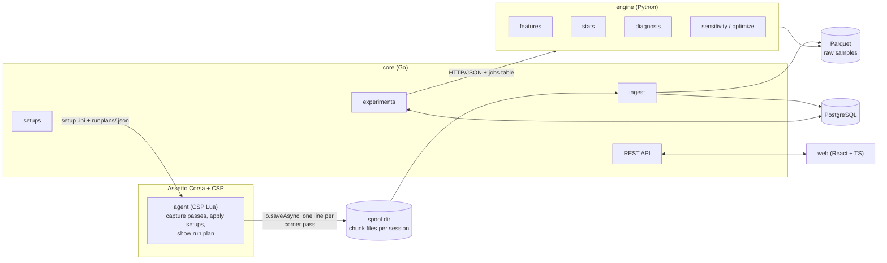
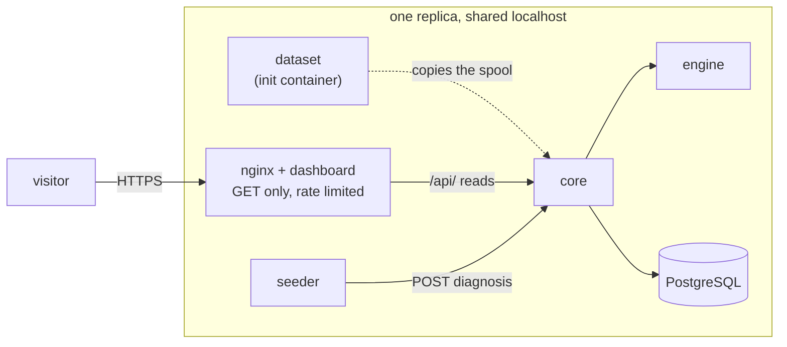

# Architecture

Apex Forge: Paddock is a **local-first modular monolith**: three processes and one database on
one Windows PC, plus a thin agent inside Assetto Corsa. The reasoning is in the ADRs
(`docs/adr/`); the full design is `docs/design.md`; the brief is `docs/MASTER_PROMPT.md`.

This file describes the target shape and marks what exists today. Changing the shape needs an
ADR.

## Processes and boundaries

| Boundary | Transport | Contract |
| --- | --- | --- |
| agent to core | Files: the agent writes numbered chunk files of JSON lines to `Documents/Assetto Corsa/paddock/spool/<session-id>/`; core tails the directory and never writes to it ([ADR 0003](adr/0003-spool-transport.md)) | `contracts/spool_session.schema.json`, `contracts/spool_pass.schema.json` |
| core to agent | Files: one run plan per car (`runplans/<car>.json`) and setup `.ini` files in `Documents/Assetto Corsa/paddock/outbox/`, read by the agent every two seconds, in the pits or while the AI drives ([ADR 0009](adr/0009-experiments.md), [ADR 0014](adr/0014-ghost-driver.md)) | `contracts/runplan.schema.json` |
| agent window to core | HTTP to core's REST API, only while the window is drawn, at most every 10 s, and on a click ([ADR 0015](adr/0015-in-game-setup-desk.md)) | `docs/api/openapi.yaml` |
| hotlap window to core | `GET /reference` only while the window is drawn, one request at a time, on a setup change and at most every 30 s ([ADR 0019](adr/0019-ai-reference-driver.md)) | `contracts/ai_reference.schema.json` |
| core to engine | HTTP/JSON on localhost; long work goes through the `jobs` table, claimed with `SELECT ... FOR UPDATE SKIP LOCKED` ([ADR 0006](adr/0006-no-kafka-no-kubernetes.md)) | `contracts/*.schema.json` |
| web to core | REST | `docs/api/openapi.yaml` |
| web to launcher | HTTP from the browser to `paddock-launcher` on the Windows host, `127.0.0.1:8090`, CORS for the dev origins only ([ADR 0017](adr/0017-host-launcher.md)) | `docs/api/launcher.yaml` |
| launcher to Content Manager | A Quick Drive preset in `Documents/Assetto Corsa/paddock/launch/` and an `acmanager://race/quick?presetFile=` URL | CM's preset format (copied from the owner's preset) |

Storage: PostgreSQL for structured data, a directory of Parquet parts per session for raw
samples, DuckDB inside the engine for queries over Parquet
([ADR 0004](adr/0004-postgres-and-parquet.md), [ADR 0007](adr/0007-ingest-libraries.md)).

## Who owns what

| Module | Language | Owns | Must never |
| --- | --- | --- | --- |
| `agent/` | CSP Lua | Corner map, pass capture with conditions, applying setup values with read-back and rollback, the setup desk window, the AI test driver and its calibration | Judge a setup, call an LLM, write anything but its own files under `paddock/` while driving |
| `core/internal/ingest` | Go | Tailing the spool, schema validation, Parquet parts, `corner_pass` rows (and the SQL for them) | Compute engineering metrics; write to the spool |
| `core/internal/setups` | Go | Parameter catalog, setup versions, `.ini` writer, diffing, linked items ([ADR 0026](adr/0026-linked-setup-items.md)) | Accept a value off the step grid or out of range; move one member of a linked group alone |
| `core/internal/experiments` | Go | Experiment state machine, run plans, verdict ledger, rollback | Do statistics (it asks the engine) |
| `core/internal/passes` | Go | Read path for a session's passes and their raw samples (Parquet) | Write anything |
| `core/internal/reference` | Go | A session's corners against the AI on the same car, track and setup: matching, the driver/car class, the technique metrics that differ, a layout grouped with its test copy when the corner maps match ([ADR 0027](adr/0027-layout-variants.md)) | Write anything; let anything but its rule decide a class |
| `core/internal/api` | Go | REST API for the dashboard and the in-game desk | Hold logic that belongs to another package |
| `core/internal/store` | Go | Database connection, migrations, the API's read queries | — |
| `core/internal/launcher` (`cmd/paddock-launcher`) | Go, on the Windows host | Listing installed cars and layouts, starting Practice through Content Manager, backing up `controls.ini` and restoring it when the game changed the bindings | Write anything outside `paddock/` except putting back its own `controls.ini` backup; change CM's presets or settings |
| `core/internal/telemetry` | Go | OpenTelemetry metrics and the Prometheus endpoint | Register anything globally |
| `engine/` | Python | Features, phases, noise model, verdict statistics, diagnosis, sensitivity, optimizer, LLM explanations | Talk to the game; let an LLM number enter the ledger |
| `web/` | TypeScript | Telemetry workspace | Hold business logic |

Rules that hold everywhere:

- **Facts come from deterministic code.** The LLM explains and ranks; it never produces a number
  that is stored.
- **A recommendation is a hypothesis with a prediction**, tested as an interleaved A-B-A-B
  experiment against a re-driven baseline. Failed experiments are kept.
- **In-game agent:** pure modules (`agent/src/core`) make no `ac.*` calls; file writes use
  `io.saveAsync`, only when there is something new, at most 5 per second; nothing heavy runs on
  the game thread; a user's setup file is never overwritten.

## The capture path (phase 1)

1. `agent/src/game/agent.lua` reads the car every frame (`carlink.lua`) and feeds
   `core/recorder.lua`, which records a pass only from a corner zone's start to its end.
   A restart, teleport, pit visit, replay or AI control drops the pass in progress.
2. A finished pass is encoded to one JSON line **one column per frame**
   (`core/spool_lines.lua`), with the conditions at that moment: fuel, tyre temperatures,
   pressures, wear, track grip, air and road temperature, wall clock, lap, setup hash; on a
   car with KERS/ERS also the battery charge at the start and end of the pass and the mean
   deployment ([ADR 0024](adr/0024-ers-state-per-pass.md)).
3. `core/spool.lua` queues lines; the shell writes every waiting line as a new chunk file, at
   most five times per second.
4. `core/internal/ingest` scans the spool every second, validates each line against the
   contract, writes the raw samples of a chunk as one Parquet part and its passes as
   `corner_pass` rows, and records the file as ingested, all idempotent on
   (session, corner, t_start).

The agent records facts only. Whether a pass is usable (off track, cold tyres, traffic) is the
engine's call in phase 2; `corner_pass.valid` stays true until then.

## Contracts and generated code

`contracts/*.schema.json` is the single source of truth for every type that crosses a process
boundary. `docs/api/openapi.yaml` describes core's REST API and refers to those schemas.

| Source | Generator | Output (never hand-edited) |
| --- | --- | --- |
| `contracts/*.schema.json` | `go-jsonschema` | `core/internal/contracts/contracts.go` |
| `contracts/*.schema.json` | `tools/sync_schemas.py` (copy) | `core/internal/ingest/schemas/` |
| `contracts/*.schema.json` | `datamodel-code-generator` | `engine/paddock_engine/contracts/` |
| `docs/api/openapi.yaml` | `openapi-typescript` | `web/src/api/schema.d.ts` |
| `docs/api/launcher.yaml` | `openapi-typescript` | `web/src/api/launcher-schema.d.ts` |

`make gen` regenerates all of them. `make gen-check` (run in CI) fails when the committed
output differs from what the generators produce. The agent's Lua writes its lines by hand; its
tests validate them against the same schema files.

## The measurement path (phase 2)

1. `engine/paddock_engine/phases/segment.py` cuts a pass into brake, entry, mid and exit
   (ported from v0 and tested against its outputs).
2. `features/` turns the samples and phases into named metrics: corner time, speeds, per-phase
   axle slip with a confidence, driver inputs (brake point, trail braking, throttle pickup,
   corrections), and the channels v0 lacked (steering per g, front saturation index, yaw
   gain). A metric's name is its id everywhere else.
3. `stats/` compares setups: one model over all corners,
   `y ~ arm + covariates + (1 | corner)` ([ADR 0008](adr/0008-effect-model.md)), each corner
   weighted by its own scatter (`stats/weights.py`,
   [ADR 0023](adr/0023-corners-weighted-by-their-own-scatter.md)), with the interval from the
   run blocks: the spread of the fit's block means, blocks - 2 degrees of freedom less one per
   covariate that changes between blocks (`stats/block_level.py`), at the level of the
   pre-registered look (`stats/sequential.py`), judged against a margin per metric and setup
   item (`config/margins.toml`) into one of eight findings (`experiments/finding.py`,
   [ADR 0029](adr/0029-block-level-inference-and-finding-classes.md)).
   `stats/mde.py` says what a plan can detect before it is driven; `stats/noise.py` measures
   the scatter per corner and `stats/lap_noise.py` the error a whole lap shares across its
   corners ([ADR 0025](adr/0025-finished-laps-and-lap-noise.md)).

The engine has no database access. Core sends it what it needs in the request and a path to
the session's Parquet parts.

## The experiment path (phase 3)

1. **Propose.** `POST /experiments` names a session, one setup item and a number of clicks.
   Core takes the champion of that car and track as the baseline (before the first
   experiment: the setup of the session's latest pass), makes the variant with
   `setups.Step` (a linked item moves with its group, [ADR 0026](adr/0026-linked-setup-items.md)), and stores the hypothesis, the predictions, the success test and the
   guardrails. Nothing changes them later.
2. **Plan.** Core asks the engine (`POST /plan`) for interleaved blocks and stores them:
   eight, the first pre-registered look
   ([ADR 0029](adr/0029-block-level-inference-and-finding-classes.md)). The engine says what that
   look decides for the scatter of single passes and of whole laps on the baseline, and when it
   cannot decide the target ([ADR 0025](adr/0025-finished-laps-and-lap-noise.md)). The two
   setups get random code names.
3. **Start.** Core writes the car's run plan (`runplans/<car>.json`) and one setup file per
   arm into the outbox. Only one experiment per car can be on it, and it must start from
   the champion. The plan says who drives: the human, or AC's AI (phase 6).
4. **Drive.** In the pits the agent shows the block to load; "Load Setup X" sets the values
   through the setup spinners with read-back and rollback. Passes are tagged with block and
   lap only while that setup is on the car; lap 0 is the out-lap. Core counts a push lap once
   the car has finished it: it reached every corner, the next block started, or nothing arrived
   for 15 minutes.
5. **Features.** Ingest queues a job per spool file; core's features worker sends the passes
   to the engine (`POST /features/session`) and stores the metrics on `corner_pass`.
6. **Evaluate.** Only once every block is driven. Core sends the valid push-lap passes on the
   block's setup and from the experiment's driver, with their covariates (time since the first
   pass, a term per game session after the first), the passes it left out, the off-track count
   per block, and the look (8, 10, 12 blocks) to `POST /evaluate`. The engine returns an effect
   and interval per channel, the guardrail checks (off-track share included), the prediction
   score, a finding, what to do next and a decision; core appends the verdict and its results
   with the engine version ([ADR 0030](adr/0030-append-only-results-and-engine-version.md)) and
   moves the state.
7. **Settle.** Accepted: the variant is the champion. Rejected: reverted in the same
   transaction. Trade-off: the driver decides. Inconclusive: extend (twice at most: the looks at
   10 and 12 blocks) or revert; a training program extends only when the engine recommends it.
   Reverting appends a zero-lap block that tells the agent to load the baseline. After three
   accepted experiments core proposes a re-check of the champion against the original.

Every move writes an `experiment_event` with its reason. The rules and what was rejected are
in [ADR 0009](adr/0009-experiments.md).

## The diagnosis path (phase 4)

1. **Ask.** `POST /sessions/{id}/diagnosis`. Core refuses while the session's features are
   still being computed. It sends the engine the valid passes driven on the setup an
   experiment would start from (every valid pass when the session has no setup data) and
   that setup's changeable items with their role, axle and scale.
2. **Evidence.** The engine averages each metric per corner class into the evidence pack.
   Every number anyone states later is an entry of the pack.
3. **Hypotheses.** Readings beyond a threshold become symptoms. Each gets a driver-input
   and a conditions alternative; driver input is marked supported when front saturation or
   the speed pattern of front slip speaks for it, which halves the hypothesis's score. The
   rule table (ported from v0's advisor) turns a symptom into candidate experiments on this
   car's items, or says why a knob cannot be tested.
4. **Words.** The provider (`none`, `gemini`, `openrouter`) puts the pack into words. A
   model's reply is shown only if every hypothesis, evidence id, identifier and number in it
   is in the pack; otherwise the template text is shown with the reason.
5. **Keep.** Core stores the reply in `diagnosis`; earlier ones stay. "Test this" on a
   candidate proposes an experiment whose hypothesis row keeps the evidence and the
   alternatives as they were shown.

The rules, the thresholds and what was rejected are in
[ADR 0010](adr/0010-diagnosis-and-explain.md).

## The learning path (phase 5)

1. **Gather.** `GET /sensitivity`. Core reads the `result` rows of every finished one-factor
   experiment, per car. Experiments still being driven, aborted ones and champion re-checks
   are left out.
2. **Pool.** The engine (`POST /sensitivity/update`) pools repeated experiments on one
   change by precision, classes the interval against the experiments' band of practical
   equivalence, and flags a response that is not mirrored or does not double.
3. **Borrow.** For a car another car can lend to, core asks again with the lender's
   measured effects on the item that does the same job. The engine returns them shrunk,
   widened and flagged `is_prior`; the car's own measurement always replaces a prior.
4. **Keep.** Core replaces the rows of `sensitivity_effect` in one transaction, with the
   method's `model_version`. The table is a record of the newest derivation, not a source.
5. **Rank.** `GET /sessions/{id}/proposals` sends the candidates of the session's newest
   diagnosis and the car's profile to `POST /propose`. The engine orders them by expected
   gain per lap and lists a change the car measured as negligible or worse as skipped.
6. **Score.** `GET /scorecard` counts the predictions that came true, in SQL.

Why it is built this way, and what is missing (the 20+ experiment optimizer, tracks and
conditions), is in [ADR 0011](adr/0011-sensitivity-and-ranking.md).

7. **Base setup.** `POST /sessions/{id}/base-setup` sends the car's profile and the
   baseline's items (each marked when it is one of a pair) to `POST /base-setup`. The engine
   takes each change measured on corner time over all corners with its interval wholly
   below zero, one per item, and predicts the sum with summed variances. Core proposes an
   experiment of kind `base` (baseline against the base setup) with that prediction, or
   answers 409 with what the car measured. Accepted, the base is the champion
   ([ADR 0018](adr/0018-base-setup.md)).

## The public demo (phase 7)

The demo mode can be shown to strangers without giving them the API. Nothing in core or
the engine knows about it.

- nginx is the only container with ingress. `POST`, `PUT`, `PATCH` and `DELETE` under
  `/api/` are answered 403 there; `/api/metrics` is 404.
- The dashboard is built with `VITE_READ_ONLY=1` and hides what a visitor cannot do.
- The replica keeps nothing. A new one ingests the recorded session again and the seeder
  diagnoses it from inside.
- `deploy/demo/docker-compose.replica.yml` is this layout in Compose and
  `infra/azure` is the same in Terraform. The first runs in CI; the second is validated
  and has never been applied ([ADR 0012](adr/0012-read-only-demo.md),
  [runbook](runbooks/deploy-demo.md)).

## The AI test driver (phase 6)

1. `tools/prepare_test_layout.py` makes `<layout>_paddock`, where Lua apps may use the
   physics API.
2. Free laps: the agent hands the car to AC's AI on the car's own grip, records the laps
   as an `ai` session, and lowers the grip the AI assumes (its tyre hint) after every lap
   where it went off, until two laps are clean.
3. An experiment with `driver: ai`: core writes the car's run plan; for every block the
   agent teleports to the pit box, repairs, sets the first block's fuel, loads the setup
   with read-back, and hands the car to the AI with the caps frozen.
4. Passes are tagged by block as for a human; core and the engine judge them the same way.

Why, and what it does not measure: [ADR 0014](adr/0014-ghost-driver.md),
[ADR 0016](adr/0016-ai-calibration.md); how: [runbooks/ghost-driver.md](runbooks/ghost-driver.md).

## The AI as the reference driver

1. `GET /sessions/{id}/reference`: `core/internal/reference` takes the session's valid passes
   on one of its setups and the AI's on the same car and track, from the newest AI session with
   three passes of the corner on that setup (else the nearest setup, said per corner). The
   track is the session's track row plus its layout's variant (`<layout>` and
   `<layout>_paddock`) when their corner maps match, read-side only and listed in `ai_tracks`
   ([ADR 0027](adr/0027-layout-variants.md)), so a lap on an original layout is compared with
   the AI on its test copy in the web app.
2. Per corner: medians, the AI's robust spread, the gaps, and the class: driver when the
   typical pass is slower than the AI by more than `max(spread, 10 ms)`, car otherwise; the
   technique metrics that differ beyond their step.
3. `GET /reference?car=&track=&layout=&setup_hash=` gives the game the AI's times on exactly
   that setup and layout, never a variant's (no AI times in the game on an original layout); the hotlap window (`agent/src/core/hotlap.lua`, `agent/src/game/hotlap.lua`)
   shows each pass against them.

The rule and its limits (the AI plans with a calibrated share of the car's tyre hint, per car and layout, on real grip: 88.5 % for the 488 GT3 at COTA, 94.1 % for the Formula Hybrid 2026 at the Hungaroring): [ADR 0019](adr/0019-ai-reference-driver.md).

## What exists today (after phase 7)

| Piece | State |
| --- | --- |
| Contracts: health, spool lines (session, catalog, setup, pass), run plan, session summary, setup item, experiment and its requests, features, plan, evaluate and diagnose requests and responses, the diagnosis and the explain reply, sensitivity request, response and profile, propose request, proposals, scorecard, base setup request, response and reply; generators and drift check | Working, checked in CI |
| agent: capture with conditions, setup catalog and setup lines, setup desk window, setup loading with read-back and rollback, block and lap tags, AI test driver with calibration, installer (`tools/install_agent.py`), test layouts (`tools/prepare_test_layout.py`) | 151 offline tests pass; capture, setup loading, run plans and AI-driven blocks **seen in game** (488 GT3, COTA); the window was not clicked in game |
| core: ingest, setup catalog and versions, features worker, experiment state machine, outbox, champion and re-check, session diagnoses, sensitivity profiles with priors between cars, proposals, scorecard, REST API for all of them, `GET /metrics` | Working, tested against a real PostgreSQL and in Docker |
| engine: phases, features, effect model, bootstrap, ROPE, MDE, noise model, diagnosis (evidence pack, rule table, driver and conditions alternatives, candidates), explanations behind a validation gate, sensitivity pooling with priors and non-linearity flags, candidate ranking, `POST /features/session`, `POST /plan`, `POST /evaluate`, `POST /diagnose`, `POST /sensitivity/update`, `POST /propose` | Working, 270 tests, `mypy --strict`; acceptance numbers are from simulation; hosted language models **unverified against the live APIs** |
| web: one workspace (session rail, overview grid, overlaid telemetry per corner, diagnosis, experiments with propose panel and scorecard, garage); a read-only build | Working, 186 tests |
| End to end: the Lua agent on the mocked game, core and the engine through a diagnosis, three experiments, and the profile, ranking and scorecard they leave (`make test-e2e`) | Passes locally and in CI |
| Demo dataset: the real v0 FA26 COTA session as a spool (`datasets/demo`), `make demo` | Working: 136 passes over 17 corners; it has no setup data, so a diagnosis but no candidates, no experiments and an empty garage |
| Read-only demo: nginx door, replica layout in Compose, smoke test (`make demo-replica`, `make demo-replica-check`) | Working locally and in CI |
| Azure deployment of the demo (`infra/azure`, `.github/workflows/publish-demo.yml`) | Terraform validated; **never applied, nothing published** |
| Base setup from the car's own measurements: `contracts/base_setup*.schema.json`, engine `POST /base-setup`, core `POST /sessions/{id}/base-setup`, experiment kind `base` (migration 00007), web "Base setup" panel in the experiments tab | Working, tested (pytest with hypothesis, Go against PostgreSQL, Vitest); **unverified in game** ([ADR 0018](adr/0018-base-setup.md)) |
| Start driving: Drive panel in the workspace, host launcher (`make launcher`) through CM's Quick Drive, `controls.ini` backup and restore ([ADR 0017](adr/0017-host-launcher.md), [runbook](runbooks/driving.md)) | Unit-tested without the game (temp folders, scripted process list); `GET /content` and `/status` read the real install; **unverified in game and in CM** |
| Human keeps the car: `ghost.hold` at agent start-up with an AI plan open, AI-plan laps counted only while the AI drives, Drive panel notices ([ADR 0021](adr/0021-human-keeps-the-car.md)) | Tested offline (agent pytest on the mocked CSP API, Vitest, Go ingest); **unverified in game** |
| Covariates left out while entangled with the arm (variance inflation > 10), named in the verdict reason ([ADR 0022](adr/0022-covariates-the-arm-can-be-told-from.md)) | Tested (pytest incl. hypothesis, replay of experiment 6's real rows offline); unverified in game |
| Corners weighted by their own scatter (inverse residual variance, floor 1.5x typical, cap 10:1), named in the verdict reason ([ADR 0023](adr/0023-corners-weighted-by-their-own-scatter.md)) | Tested (pytest incl. hypothesis, coverage simulations, replay of experiments 5 to 10's real rows offline); unverified in game |
| Hybrid battery per pass: `ers` on the pass line (CSP `kersCharge`, `kersInput`, only with `kersPresent`), `corner_pass.ers_*` (migration 00010), the start charge sent as covariate `ers_charge_start` ([ADR 0024](adr/0024-ers-state-per-pass.md)) | Tested offline (agent pytest on the mocked CSP API, Go ingest against PostgreSQL, pytest simulation); **unverified in game** |
| A lap counts once finished (every corner, next block, or 15 minutes quiet); plans sized for lap noise (`stats/lap_noise.py`, eight blocks since ADR 0029, target of four bands, `sigma_lap` and `target_met` on the plan) ([ADR 0025](adr/0025-finished-laps-and-lap-noise.md)) | Tested (Go table-driven and against PostgreSQL, pytest incl. hypothesis and simulations, Vitest, offline replay of experiments 5 and 7 to 10's baselines); **unverified in game** |
| Linked setup items are one setting: detected per car (same label and range, equal in every setup read back from the car, at least 3, and moved) or declared (`setups.DeclaredLinks`: FH26 `WING_1` + `WING_9`); experiments, base setups, setup items, ranking and training treat a group as one item, labelled `Rear Wing (WING_1 + WING_9)` ([ADR 0026](adr/0026-linked-setup-items.md)) | Tested (Go table-driven and against PostgreSQL, Vitest; detection run read-only on the real rows: FH26 rear wing found, nothing on the Ferrari 488 GT3); **unverified in game** |
| AI training program: `core/internal/training`, `POST /sessions/{id}/training`, `GET /training`, migration 00008, the window's Calibrate and Train buttons, web "Train the AI" card | Working, tested (Go against PostgreSQL with a scripted ledger, agent pytest, Vitest); **one AI experiment driven in game, a whole program not yet** ([ADR 0020](adr/0020-ai-training-program.md)) |
| Block-level intervals, pre-registered looks at 8, 10 and 12 blocks (O'Brien-Fleming, 70 % of the 5 % spent), eight findings with a recommendation, margins per metric and setup item (`engine/paddock_engine/config/margins.toml`), Holm for driver inputs and speed-class interactions, off-track share as a guardrail, passes on another setup or from another driver left out and counted, every block driven before a manual evaluate ([ADR 0029](adr/0029-block-level-inference-and-finding-classes.md)); results kept per verdict with the engine version (migration 00012, [ADR 0030](adr/0030-append-only-results-and-engine-version.md)) | Tested (pytest incl. hypothesis and known-truth simulations, a real-data A/A and replay of experiments 11, 12 and 15 to 19 offline, Go table-driven and against PostgreSQL, Vitest, the end-to-end test on the mocked game); **unverified in game** |
| Surrogate optimizer for 20+ experiments (Thompson sampling), profile per track and conditions | Not built ([ADR 0011](adr/0011-sensitivity-and-ranking.md)) |
| Ghost Driver level 3 (own controller over CSP Custom AI, manoeuvres) | Not started |
| AI as the reference driver: `GET /sessions/{id}/reference`, `GET /reference`, the hotlap window, "Against the AI" and the AI overlay in the dashboard ([ADR 0019](adr/0019-ai-reference-driver.md)) | Tested offline and against a real PostgreSQL; run on real AI sessions only; the window is **unverified in game** |
| A layout and its test copy are one track in the web app: an original-layout session is compared with the AI on `<layout>_paddock` when the corner maps match (same numbers, apexes within 5 m), `ai_tracks` and `variant_note` on the reply; the game's `GET /reference` stays exact ([ADR 0027](adr/0027-layout-variants.md)) | Tested (Go table-driven and against PostgreSQL, Vitest, agent pytest); run read-only on the real rows (COTA groups, the Hungaroring has no original row yet); **unverified in game and in a browser** |

The data model (`docs/MASTER_PROMPT.md` section 3) is introduced table by table, each in the
phase that first uses it.

## Configuration and ports

| Process | Port | Environment variables |
| --- | --- | --- |
| core | 8080 | `PADDOCK_DATABASE_URL` (required), `PADDOCK_HTTP_ADDR` (default `:8080`), `PADDOCK_SPOOL_DIR` (the agent's spool; unset turns ingest off), `PADDOCK_DATA_DIR` (Parquet files; default `data`), `PADDOCK_ENGINE_URL` (unset: no features, experiments cannot be planned or judged), `PADDOCK_OUTBOX_DIR` (the agent's outbox; unset: nothing is written for the agent) |
| engine | 8000 | `PADDOCK_LLM_PROVIDER` (`none`, `gemini` or `openrouter`; unset: Gemini when its key is present, otherwise no model), `PADDOCK_LLM_MODEL` (model id; default per provider), `GEMINI_API_KEY`, `OPENROUTER_API_KEY` (environment, or the OS keyring under service `paddock` when the `keyring` package is installed) |
| web (dev server) | 5173 | `PADDOCK_CORE_URL` (default `http://localhost:8080`), target of the `/api` proxy |
| paddock-launcher (Windows host) | 8090 on 127.0.0.1 | `PADDOCK_AC_ROOT` (default the Steam folder), `PADDOCK_DOCUMENTS` (default the Documents known folder), `PADDOCK_CM_PRESET` (CM Quick Drive preset name or path; default `NJ`); flags `--ac-root`, `--documents`, `--template`, `--port`. The dashboard reads `VITE_PADDOCK_LAUNCHER_URL` (default `http://127.0.0.1:8090`) |
| PostgreSQL | 5432 | Set in `deploy/docker-compose.yml` |
| web (demo image, nginx) | 8088 | `PADDOCK_WEB_PORT` (default `8088`), `PADDOCK_CORE_URL` (default `http://localhost:8080`); built with `VITE_READ_ONLY=1` |

In Docker, `PADDOCK_SPOOL_HOST` is the host folder mounted read-only as core's spool and
`PADDOCK_OUTBOX_HOST` the host folder mounted as its outbox. The engine mounts core's data
volume read-only at the same path, because core hands it the directory of a session's Parquet
files. Every port is bound to `127.0.0.1`. Nothing needs a cloud service to run locally; a hosted language model is used only when a key is given, and then it receives the evidence pack and nothing else.
