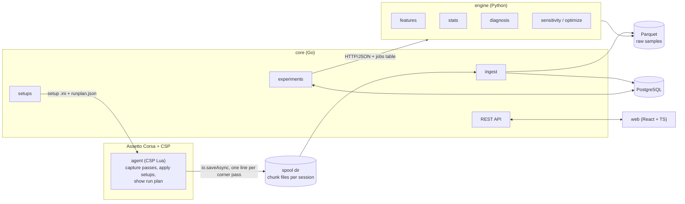

# Architecture

Apex Forge: Paddock is a **local-first modular monolith**: three processes and one database on
one Windows PC, plus a thin agent inside Assetto Corsa. The reasoning is in the ADRs
(`docs/adr/`); the full design is `docs/design.md`; the brief is `docs/MASTER_PROMPT.md`.

This file describes the target shape and marks what exists today. Changing the shape needs an
ADR.

## Processes and boundaries

| Boundary | Transport | Contract |
| --- | --- | --- |
| agent to core | Files: the agent writes numbered chunk files of JSON lines to `Documents/Assetto Corsa/paddock/spool/<session-id>/`; core tails the directory and never writes to it ([ADR 0003](adr/0003-spool-transport.md)) | `contracts/spool_session.schema.json`, `contracts/spool_pass.schema.json` |
| core to agent | Files: `runplan.json` and setup `.ini` files in `Documents/Assetto Corsa/paddock/outbox/`, read by the agent every two seconds, in the pits only ([ADR 0009](adr/0009-experiments.md)) | `contracts/runplan.schema.json` |
| core to engine | HTTP/JSON on localhost; long work goes through the `jobs` table, claimed with `SELECT ... FOR UPDATE SKIP LOCKED` ([ADR 0006](adr/0006-no-kafka-no-kubernetes.md)) | `contracts/*.schema.json` |
| web to core | REST | `docs/api/openapi.yaml` |

Storage: PostgreSQL for structured data, a directory of Parquet parts per session for raw
samples, DuckDB inside the engine for queries over Parquet
([ADR 0004](adr/0004-postgres-and-parquet.md), [ADR 0007](adr/0007-ingest-libraries.md)).

## Who owns what

| Module | Language | Owns | Must never |
| --- | --- | --- | --- |
| `agent/` | CSP Lua | Corner map, pass capture with conditions, applying setup values with read-back and rollback, showing the run plan | Judge a setup, call an LLM, write anything but the spool while driving |
| `core/internal/ingest` | Go | Tailing the spool, schema validation, Parquet parts, `corner_pass` rows (and the SQL for them) | Compute engineering metrics; write to the spool |
| `core/internal/setups` | Go | Parameter catalog, setup versions, `.ini` writer, diffing | Accept a value off the step grid or out of range |
| `core/internal/experiments` | Go | Experiment state machine, run plans, verdict ledger, rollback | Do statistics (it asks the engine) |
| `core/internal/api` | Go | REST API for the dashboard | Hold logic that belongs to another package |
| `core/internal/store` | Go | Database connection, migrations, the API's read queries | — |
| `core/internal/telemetry` | Go | OpenTelemetry metrics and the Prometheus endpoint | Register anything globally |
| `engine/` | Python | Features, phases, noise model, verdict statistics, diagnosis, sensitivity, optimizer, LLM explanations | Talk to the game; let an LLM number enter the ledger |
| `web/` | TypeScript | Dashboard | Hold business logic |
| `ghost/` | Go | Ghost Driver research (phase 6, optional, behind a flag) | Run without its safety envelope |

Rules that hold everywhere:

- **Facts come from deterministic code.** The LLM explains and ranks; it never produces a number
  that is stored.
- **A recommendation is a hypothesis with a prediction**, tested as an interleaved A-B-A-B
  experiment against a re-driven baseline. Failed experiments are kept.
- **In-game agent:** pure modules (`agent/src/core`) make no `ac.*` calls; file writes use
  `io.saveAsync`, only when there is something new, at most 5 per second; nothing heavy runs on
  the game thread; a user's setup file is never overwritten.

## The capture path (phase 1)

1. `agent/src/game/agent.lua` reads the car every frame (`carlink.lua`) and feeds
   `core/recorder.lua`, which records a pass only from a corner zone's start to its end.
   A restart, teleport, pit visit, replay or AI control drops the pass in progress.
2. A finished pass is encoded to one JSON line **one column per frame**
   (`core/spool_lines.lua`), with the conditions at that moment: fuel, tyre temperatures,
   pressures, wear, track grip, air and road temperature, wall clock, lap, setup hash.
3. `core/spool.lua` queues lines; the shell writes every waiting line as a new chunk file, at
   most five times per second.
4. `core/internal/ingest` scans the spool every second, validates each line against the
   contract, writes the raw samples of a chunk as one Parquet part and its passes as
   `corner_pass` rows, and records the file as ingested, all idempotent on
   (session, corner, t_start).

The agent records facts only. Whether a pass is usable (off track, cold tyres, traffic) is the
engine's call in phase 2; `corner_pass.valid` stays true until then.

## Contracts and generated code

`contracts/*.schema.json` is the single source of truth for every type that crosses a process
boundary. `docs/api/openapi.yaml` describes core's REST API and refers to those schemas.

| Source | Generator | Output (never hand-edited) |
| --- | --- | --- |
| `contracts/*.schema.json` | `go-jsonschema` | `core/internal/contracts/contracts.go` |
| `contracts/*.schema.json` | `tools/sync_schemas.py` (copy) | `core/internal/ingest/schemas/` |
| `contracts/*.schema.json` | `datamodel-code-generator` | `engine/paddock_engine/contracts/` |
| `docs/api/openapi.yaml` | `openapi-typescript` | `web/src/api/schema.d.ts` |

`make gen` regenerates all of them. `make gen-check` (run in CI) fails when the committed
output differs from what the generators produce. The agent's Lua writes its lines by hand; its
tests validate them against the same schema files.

## The measurement path (phase 2)

1. `engine/paddock_engine/phases/segment.py` cuts a pass into brake, entry, mid and exit
   (ported from v0 and tested against its outputs).
2. `features/` turns the samples and phases into named metrics: corner time, speeds, per-phase
   axle slip with a confidence, driver inputs (brake point, trail braking, throttle pickup,
   corrections), and the channels v0 lacked (steering per g, front saturation index, yaw
   gain). A metric's name is its id everywhere else.
3. `stats/` compares setups: one model over all corners,
   `y ~ arm + covariates + (1 | corner)`, a block bootstrap over laps for the interval, and a
   classification against a region of practical equivalence
   ([ADR 0008](adr/0008-effect-model.md)). `stats/mde.py` says what a plan can detect before
   it is driven; `stats/noise.py` measures the scatter per corner.

The engine has no database access. Core sends it what it needs in the request and a path to
the session's Parquet parts.

## The experiment path (phase 3)

1. **Propose.** `POST /experiments` names a session, one setup item and a number of clicks.
   Core takes the champion of that car and track as the baseline (before the first
   experiment: the setup of the session's latest pass), makes the variant with
   `setups.Step`, and stores the hypothesis, the predictions, the success test and the
   guardrails. Nothing changes them later.
2. **Plan.** Core asks the engine (`POST /plan`) what four interleaved blocks can detect and
   stores the blocks. The two setups get random code names.
3. **Start.** Core writes `runplan.json` and one setup file per arm into the outbox. Only one
   experiment can be on the car, and it must start from the champion.
4. **Drive.** In the pits the agent shows the block to load; "Load Setup X" sets the values
   through the setup spinners with read-back and rollback. Passes are tagged with block and
   lap only while that setup is on the car; lap 0 is the out-lap.
5. **Features.** Ingest queues a job per spool file; core's features worker sends the passes
   to the engine (`POST /features/session`) and stores the metrics on `corner_pass`.
6. **Evaluate.** Core sends the valid push-lap passes with their covariates to
   `POST /evaluate`. The engine returns an effect and interval per channel, the guardrail
   checks, the prediction score and a decision; core stores them and moves the state.
7. **Settle.** Accepted: the variant is the champion. Rejected: reverted in the same
   transaction. Trade-off: the driver decides. Inconclusive: extend (twice at most) or revert.
   Reverting appends a zero-lap block that tells the agent to load the baseline. After three
   accepted experiments core proposes a re-check of the champion against the original.

Every move writes an `experiment_event` with its reason. The rules and what was rejected are
in [ADR 0009](adr/0009-experiments.md).

## The diagnosis path (phase 4)

1. **Ask.** `POST /sessions/{id}/diagnosis`. Core refuses while the session's features are
   still being computed. It sends the engine the valid passes driven on the setup an
   experiment would start from (every valid pass when the session has no setup data) and
   that setup's changeable items with their role, axle and scale.
2. **Evidence.** The engine averages each metric per corner class into the evidence pack.
   Every number anyone states later is an entry of the pack.
3. **Hypotheses.** Readings beyond a threshold become symptoms. Each gets a driver-input
   and a conditions alternative; driver input is marked supported when front saturation or
   the speed pattern of front slip speaks for it, which halves the hypothesis's score. The
   rule table (ported from v0's advisor) turns a symptom into candidate experiments on this
   car's items, or says why a knob cannot be tested.
4. **Words.** The provider (`none`, `gemini`, `openrouter`) puts the pack into words. A
   model's reply is shown only if every hypothesis, evidence id, identifier and number in it
   is in the pack; otherwise the template text is shown with the reason.
5. **Keep.** Core stores the reply in `diagnosis`; earlier ones stay. "Test this" on a
   candidate proposes an experiment whose hypothesis row keeps the evidence and the
   alternatives as they were shown.

The rules, the thresholds and what was rejected are in
[ADR 0010](adr/0010-diagnosis-and-explain.md).

## The learning path (phase 5)

1. **Gather.** `GET /sensitivity`. Core reads the `result` rows of every finished one-factor
   experiment, per car. Experiments still being driven, aborted ones and champion re-checks
   are left out.
2. **Pool.** The engine (`POST /sensitivity/update`) pools repeated experiments on one
   change by precision, classes the interval against the experiments' band of practical
   equivalence, and flags a response that is not mirrored or does not double.
3. **Borrow.** For a car another car can lend to, core asks again with the lender's
   measured effects on the item that does the same job. The engine returns them shrunk,
   widened and flagged `is_prior`; the car's own measurement always replaces a prior.
4. **Keep.** Core replaces the rows of `sensitivity_effect` in one transaction, with the
   method's `model_version`. The table is a record of the newest derivation, not a source.
5. **Rank.** `GET /sessions/{id}/proposals` sends the candidates of the session's newest
   diagnosis and the car's profile to `POST /propose`. The engine orders them by expected
   gain per lap and lists a change the car measured as negligible or worse as skipped.
6. **Score.** `GET /scorecard` counts the predictions that came true, in SQL.

Why it is built this way, and what is missing (the 20+ experiment optimizer, tracks and
conditions), is in [ADR 0011](adr/0011-sensitivity-and-ranking.md).

## What exists today (after phase 5)

| Piece | State |
| --- | --- |
| Contracts: health, spool lines (session, catalog, setup, pass), run plan, session summary, setup item, experiment and its requests, features, plan, evaluate and diagnose requests and responses, the diagnosis and the explain reply, sensitivity request, response and profile, propose request, proposals, scorecard; generators and drift check | Working, checked in CI |
| agent: capture with conditions, setup catalog and setup lines, run-plan window, setup loading with read-back and rollback, block and lap tags, installer (`tools/install_agent.py`) | 97 offline tests pass; **unverified in game** |
| core: ingest, setup catalog and versions, features worker, experiment state machine, outbox, champion and re-check, session diagnoses, sensitivity profiles with priors between cars, proposals, scorecard, REST API for all of them, `GET /metrics` | Working, tested against a real PostgreSQL and in Docker |
| engine: phases, features, effect model, bootstrap, ROPE, MDE, noise model, diagnosis (evidence pack, rule table, driver and conditions alternatives, candidates), explanations behind a validation gate, sensitivity pooling with priors and non-linearity flags, candidate ranking, `POST /features/session`, `POST /plan`, `POST /evaluate`, `POST /diagnose`, `POST /sensitivity/update`, `POST /propose` | Working, 132 tests, `mypy --strict`; acceptance numbers are from simulation; hosted language models **unverified against the live APIs** |
| web: sessions, diagnosis page with what to test next, propose form (also filled from a candidate, with its predicted gain), experiment page with its full history, ledger with the scorecard, garage | Working, 75 tests |
| End to end: the Lua agent on the mocked game, core and the engine through a diagnosis, three experiments, and the profile, ranking and scorecard they leave (`make test-e2e`) | Passes locally and in CI |
| Demo dataset: the real v0 FA26 COTA session as a spool (`datasets/demo`), `make demo` | Working: 136 passes over 17 corners; it has no setup data, so a diagnosis but no candidates, no experiments and an empty garage |
| Surrogate optimizer for 20+ experiments (Thompson sampling), profile per track and conditions | Not built ([ADR 0011](adr/0011-sensitivity-and-ranking.md)) |
| Ghost Driver | Not started (phase 6, gated on the game) |

The data model (`docs/MASTER_PROMPT.md` section 3) is introduced table by table, each in the
phase that first uses it.

## Configuration and ports

| Process | Port | Environment variables |
| --- | --- | --- |
| core | 8080 | `PADDOCK_DATABASE_URL` (required), `PADDOCK_HTTP_ADDR` (default `:8080`), `PADDOCK_SPOOL_DIR` (the agent's spool; unset turns ingest off), `PADDOCK_DATA_DIR` (Parquet files; default `data`), `PADDOCK_ENGINE_URL` (unset: no features, experiments cannot be planned or judged), `PADDOCK_OUTBOX_DIR` (the agent's outbox; unset: nothing is written for the agent) |
| engine | 8000 | `PADDOCK_LLM_PROVIDER` (`none`, `gemini` or `openrouter`; unset: Gemini when its key is present, otherwise no model), `PADDOCK_LLM_MODEL` (model id; default per provider), `GEMINI_API_KEY`, `OPENROUTER_API_KEY` (environment, or the OS keyring under service `paddock` when the `keyring` package is installed) |
| web (dev server) | 5173 | `PADDOCK_CORE_URL` (default `http://localhost:8080`), target of the `/api` proxy |
| PostgreSQL | 5432 | Set in `deploy/docker-compose.yml` |

In Docker, `PADDOCK_SPOOL_HOST` is the host folder mounted read-only as core's spool and
`PADDOCK_OUTBOX_HOST` the host folder mounted as its outbox. The engine mounts core's data
volume read-only at the same path, because core hands it the directory of a session's Parquet
files. Every port is bound to `127.0.0.1`. Nothing needs a cloud service to run locally; a hosted language model is used only when a key is given, and then it receives the evidence pack and nothing else.
