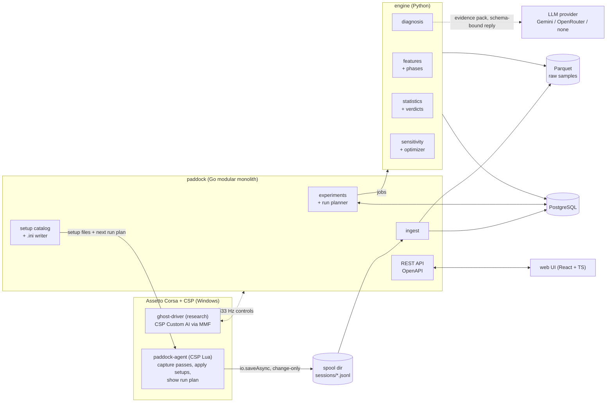
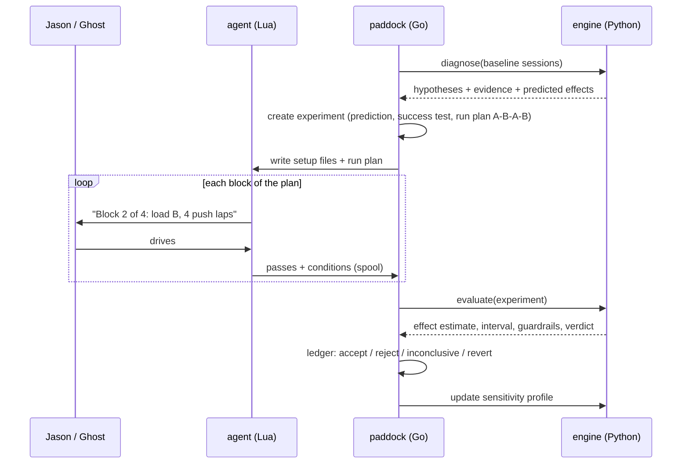
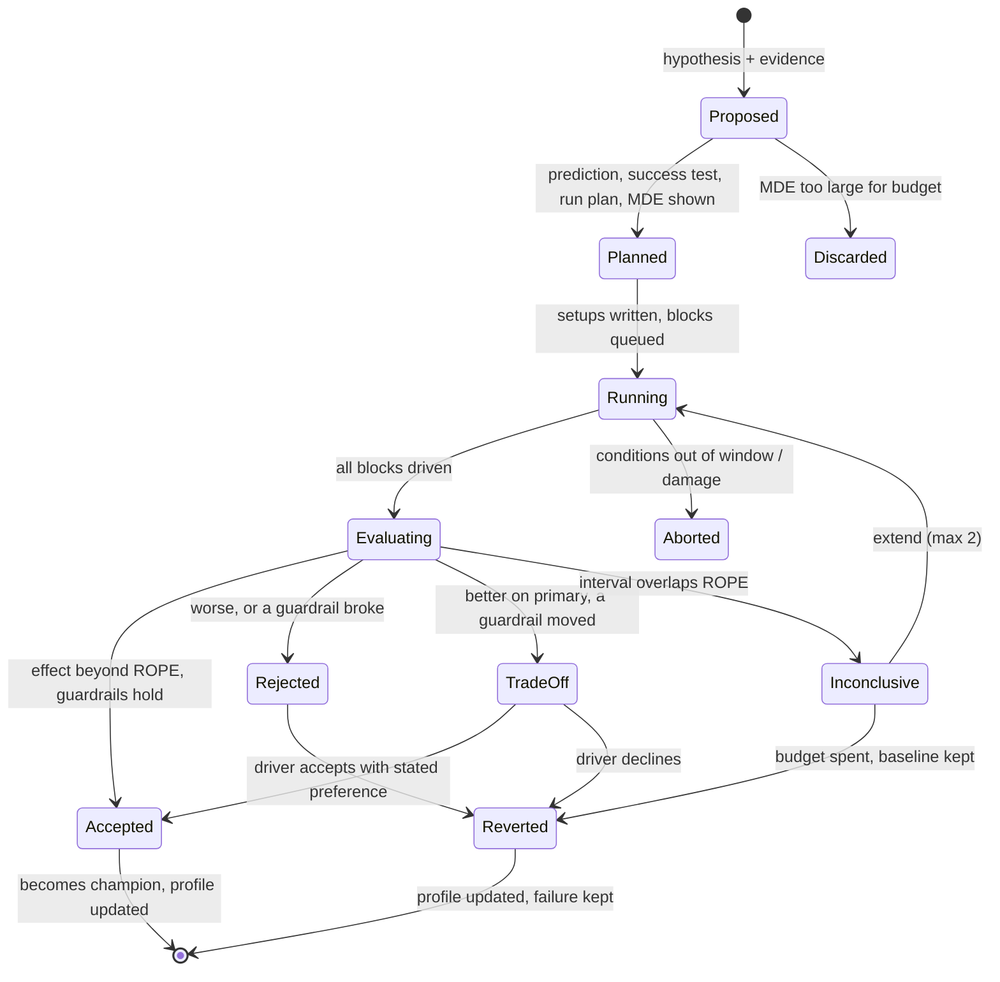

# Apex Forge: Paddock — Audit, Architecture & Master Prompt

Nov 11, 2026 · @Jason

## Summary

**Verdict: keep Apex Forge's in-game capture layer, replace its judgement layer.** The corner recorder, setup validation and offline test harness are genuinely good. The parts that decide *what is wrong* and *whether a change worked* are where the regressions came from, and they cannot be fixed by tuning thresholds.

Three findings drive the whole redesign:

1. **The balance metric was measuring something setups don't change.** On Jason's real FA26 COTA log, mid-corner "understeer" is +4.2° below 100 km/h but +0.7° above 150 km/h, and rear slip stays flat at about 3°. Eight setup versions of bar and bias changes barely moved it. The app kept prescribing anti-roll bar changes for what is most likely steering input past the front tyre's peak, plus low-speed geometry.
2. **The verdict logic cannot tell a real change from noise.** Simulating the current `learner.compare` + `outcome.evaluate` rules on Jason's measured scatter (28 ms per corner), two *identical* setups get flagged "slower in 2+ corners, more slower than faster" **39% of the time** at 3 passes per corner. That is the trigger for a Regression verdict.
3. **Versions were never compared under comparable conditions.** Setups were driven one after another (base, v2 … v9), each judged only against its parent, with no re-run of the baseline and no record of fuel, tyre temperature or time per pass. Track evolution and Jason learning the track look exactly like setup effects.

**The path:** Paddock is a local-first modular monolith (Go API + Python analysis engine + Postgres/Parquet + a React dashboard), with the existing CSP Lua app slimmed into a telemetry and setup agent. Every change becomes an experiment with a prediction, a pre-registered success test, an interleaved A/B/A run plan and a recorded verdict. Ghost Driver is feasible through CSP's experimental Custom AI interface (333 Hz control via memory-mapped files), but it is a research track with its own milestones, never a dependency.

Each claim below is marked **Verified** (documented or seen in Jason's own working code), **Limited**, **Experimental**, or **Proposed** (custom work).

## A. Existing repository assessment

Moved to its own file so the code and ADRs can cite it: [audit-v0.md](audit-v0.md).

## B. Product vision

**Apex Forge: Paddock is a vehicle engineering lab that treats every setup change as an experiment and keeps score honestly.** It is not a telemetry viewer and not an LLM wrapper. Its unit of work is the *experiment*: a hypothesis, a predicted effect, a run plan, a measured result and a verdict that can say "I was wrong".

**Core capabilities, in the order they earn their place:**

1. **Capture.** Per-corner passes with full conditions (fuel, tyre temps, wear, grip, time) from a slim CSP agent, streamed to a local backend.
2. **Measure.** A noise model per car, track and driver, so every comparison comes with an interval and a minimum detectable effect.
3. **Diagnose.** Evidence-backed hypotheses ("front saturated in slow-corner mid-phase: steering up 18% after peak lateral g, lateral g flat") with alternative explanations, including "driver input, not setup".
4. **Experiment.** Interleaved A/B/A run plans, pre-registered success tests, automatic setup generation and rollback, and a verdict ledger that keeps failures.
5. **Learn the car.** A per-car sensitivity profile built from one-click experiments, with uncertainty, reused with care across tracks and similar cars.
6. **Optimize.** Choose the next experiment by expected value of information, not by a fixed rule order.
7. **Ghost Driver (research).** Repeatable machine-driven test laps so the sensitivity profile can be built without Jason driving every lap.

**Design principles:**

- Facts come from deterministic code; the LLM interprets and explains, never invents numbers or overrides a calculation.
- A recommendation is a hypothesis with a falsifiable prediction.
- The baseline is re-driven; conditions are recorded; noise is measured, not assumed.
- Driver preferences are configuration ("responsive front, tolerate active rear, mid-corner balance matters most"), not code.
- Everything works with Jason driving (Level 1). Ghost Driver only makes it faster.
- Local-first: runs on one Windows PC, with a demo mode that runs anywhere from recorded data.

## C. Target architecture

**Recommendation: a local-first modular monolith with three processes (Go, Python, a browser UI) and one database.** The CSP app becomes a thin agent. No Kafka, no Kubernetes at runtime, no microservices. Cloud appears only as an optional, read-only demo deployment.



### Components and responsibilities

| Component | Language | Owns | Must never |
| --- | --- | --- | --- |
| `agent` (in-game) | CSP Lua | Corner map lookup, pass capture with conditions, apply/read-back of setup values, showing the current run plan | Judge a setup, call an LLM, write more than the spool file while driving |
| `ingest` | Go | Tailing the spool, validating against the schema, writing Parquet and pass rows | Compute engineering metrics |
| `experiments` | Go | Experiment state machine, run plans, versioned setups, rollback, verdict ledger | Do statistics itself (it calls the engine) |
| `setups` | Go | Car parameter catalog (from the agent's spinner export), `.ini` writer, diffing | Accept a value outside the step grid or range |
| `engine` | Python | Features, phases, diagnosis, noise model, verdicts, sensitivity, optimizer | Talk to the game or the database schema directly except through its repository layer |
| `explain` | Python (in engine) | LLM evidence packs and schema-validated replies | Let an LLM number enter the ledger |
| `web` | TypeScript, React, Vite | Dashboard, experiment review, corner explorer, demo mode | Hold business logic |
| `ghost` | Go first, Rust only if measured jitter demands it | Controller loop over CSP Custom AI | Run without the safety envelope (section D) |

### Technology choices

| Choice | Decision | Why |
| --- | --- | --- |
| Agent to backend transport | **Spool files** (`io.saveAsync`, one JSONL per session, flushed per pass) | Same proven pattern as MusicBlender; crash-safe; zero game-thread risk. HTTP via CSP `web.post` to localhost is a later option, unverified against localhost |
| Backend | **Go** | Ingest, API, orchestration; a clean single binary; good for the platform-engineering story |
| Analysis | **Python** (numpy, pandas/polars, scipy, statsmodels) | The statistics and optimization ecosystem lives here |
| Go to Python | **HTTP + JSON Schema contracts**, jobs tracked in a Postgres table | Two processes, one contract source (`contracts/`), code-generated types on both sides; no message broker |
| Structured store | **PostgreSQL** via Docker Compose | Experiments, setups, verdicts and sensitivity are relational; migrations reviewed (goose or Atlas) |
| Raw telemetry | **Parquet** per session + **DuckDB** for queries | 333 Hz-capable columnar storage without a time-series database |
| UI | **React + Vite + TypeScript** | Next.js adds server rendering a local app does not need: **not recommended** |
| Contracts | JSON Schema to Go structs + Pydantic models | Replaces "Pydantic or equivalent" with one source of truth across both languages |
| Observability | OpenTelemetry traces and metrics, Prometheus + Grafana as an optional Compose profile | Shows the skill without becoming the project |
| Infrastructure | Docker Compose locally; **Terraform + Azure Container Apps** for a read-only public demo | AKS is overkill for one stateless demo; say so in an ADR, which is itself a good interview answer |
| Kafka, Kubernetes runtime, microservices | **No** | One user, one PC, \~10 MB per session. Write the ADR explaining when they would be justified |
| Rust | **Only** for the Ghost Driver loop, and only after Go measures jitter above budget | Concrete systems-level trigger, not decoration |

### Experiment data flow



## D. Ghost Driver feasibility study

**Verdict: autonomous control is feasible offline, but the valuable first use is a virtual proving ground, not a racing driver.** A machine that drives repeatable constant-radius, step-steer and brake-in-turn manoeuvres will characterize a car far faster and with less noise than any lap-time race between setups. Lap-pace autonomous driving is a research milestone with no guarantee.

### What Assetto Corsa and CSP actually offer

| Capability | Status | What it gives | Limits |
| --- | --- | --- | --- |
| AC shared memory (physics, graphics, static pages) | **Verified** | Read-only car state at physics rate ([C# reader](https://github-redirect.dependabot.com/mdjarv/assettocorsasharedmemory)) | No control |
| AC Remote Telemetry UDP, port 9996 | **Verified** | Handshake + per-step car info incl. per-wheel slip angles and loads ([protocol doc](https://docs.google.com/document/d/1KfkZiIluXZ6mMhLWfDX1qAGbvhGRC3ZUzjVIt5FQpp4/pub)) | Read-only; the protocol has no control messages |
| Setup read, apply, save, load from a CSP app | **Verified** in Jason's own working code | `ac.getSetupSpinners`, `ac.setSetupSpinnerValue`, `ac.saveCurrentSetup`, `ac.loadSetup`, `ac.onSessionStart` | Apply only in the pits / setup screen |
| Virtual joystick (vJoy) driven by an external process | **Verified** by research use | `assetto_corsa_gym` (NeurIPS 2024) drives AC through vJoy at 25 Hz with telemetry from a plugin + shared memory; SAC agents reach near-human laps after days of training ([paper](https://arxiv.org/html/2407.16680v1)) | Real time only, Windows only, 25–100 Hz, needs AC's controls mapped to the virtual device |
| ViGEmBus virtual gamepad | **Avoid** | — | Retired and archived in 2023 ([end of life](https://docs.nefarius.at/projects/ViGEm/End-of-Life/)) |
| CSP **Custom AI** via memory-mapped files | **Experimental** (documented) | Replace a car's controller; inputs read at 333 Hz; per-car state; sim control with pause, `restart_session`, disable collisions ([CSP docs](https://cup.acstuff.club/docs/csp/other-things/custom-ai)) | Must be enabled in `new_behaviour.ini`; the track needs `ALLOW_CUSTOM_AI_MANIPULATION=1` and extended physics; offline only. Whether it can take car 0 (the player) is **unverified** |
| AC's own AI driving the player car (autopilot) from a CSP Lua app | **Limited** | Community app BotMate hands the player car to AC's AI and back ([BotMate](https://www.overtake.gg/downloads/botmate-csp-required.62750/)) | Needs extended physics plus physics access (RARE or a `surfaces.ini` edit); AI behaviour depends on the track's AI line quality |
| Car physics scripts (`script.lua` in the car's data folder) | **Verified** (documented) | Can modify user controls, e.g. `data.gas = 0` ([CSP docs](https://cup.acstuff.club/docs/csp/cars/physics-scripts)) | Needs extended physics and editing the car's data, which is a modification to a third-party car; unsuitable as the main path |
| Gamepad input scripts (`ac_joypad_assist`) | **Limited** | The SDK ships a joypad-assist script type ([SDK](https://www.github.com/ac-custom-shaders-patch/acc-lua-sdk)) used by gamepad assists such as [Advanced Gamepad Assist](https://www.overtake.gg/downloads/advanced-gamepad-assist.62485) | Built for gamepads; behaviour with a wheel is unverified |
| AI tuning by Lua (grip perception, braking) | **Limited** | [Full Send AI](https://github.com/Eddlm/Full-Send-AI) adjusts AI perceived grip per 50 m section to make AI faster | Shows the AI's pace comes from heuristics, not from the car's potential |

**Not found and not assumed:** an official Kunos autonomous-driving API, faster-than-real-time simulation, or a documented way to force AI cars onto a custom setup.

### The three levels

| Level | What it is | Feasibility | Value |
| --- | --- | --- | --- |
| **1. Assisted testing** | Jason drives; Paddock generates setups, writes the run plan (A-B-A-B blocks), records conditions, picks test corners, scores the result | **High.** Uses only verified APIs Apex Forge already calls | Fixes every regression cause in section A on its own |
| **2. AC AI as test driver** | Hand the player car to AC's AI (autopilot) and run baseline and variant laps | **Medium.** Works per BotMate, needs physics access | The AI is a fixed, heuristic policy: highly repeatable, but its lap-time response to a setup measures how the AI copes, not the car. Useful for balance and slip channels; weak for lap-time optimization |
| **3. Ghost Driver** | Paddock's own controller over CSP Custom AI | **Medium for manoeuvres, low for limit laps** | Manoeuvres give clean physics data; limit laps need a vehicle model and MPC, a real research project |

### Recommended controller design

- **Lateral:** pure pursuit for low speed, Stanley for higher speed, on a reference path from the track's AI spline or a recorded clean lap of Jason's. Both are explainable, testable offline against a bicycle model, and need no training.
- **Longitudinal:** a PI speed controller tracking a speed profile. Start at 80% of the AI line's speed, then raise it in steps.
- **Manoeuvre library (the proving ground):** constant radius at stepped speeds (gives understeer gradient, the steering angle vs lateral g curve, and front/rear saturation points), step steer (yaw response), brake-in-turn (entry stability), power-on exit (traction and diff). These map directly onto setup parameters.
- **MPC:** only after the manoeuvre data has identified a per-car model good enough to predict 1 s ahead. Justify it with a measured tracking-error gap, not by default.
- **Reinforcement learning:** **not recommended** here. The benchmark above needed about 4 days of real-time training per car and track, and an RL policy re-adapts to each setup, which hides the very effect being measured.
- **Safety envelope:** off-track or yaw-rate limit triggers lift, brake and hand-back; watchdog stops if the controller misses 3 inputs; an offline-only check; a session time cap.

### Milestones (each independently useful)

1. **G0, read path (1–2 days):** a Go reader for shared memory and the Custom AI car-state file; log at 333 Hz to Parquet. Gate: lossless, timestamps monotonic.
2. **G1, prove control (1 week):** enable Custom AI on one permitted track; drive a straight-line throttle/brake script on an AI car, then try car 0. Gate: inputs land at 100 Hz+ with < 10 ms jitter; documented answer on player-car control.
3. **G2, path following (1–2 weeks):** pure pursuit + PI at 70–80% pace for 5 clean laps. Gate: lateral error < 0.5 m RMS, lap-time spread < 0.3%.
4. **G3, proving ground (2 weeks):** constant-radius and step-steer manoeuvres; compare two setups. Gate: repeat runs agree within the noise model, and a one-click bar change produces a measurable shift in the steady-state understeer gradient.
5. **G4, automated sweep:** load setup, run manoeuvres, restart, repeat across ±1 click per parameter, unattended. Gate: a full sensitivity profile overnight.
6. **G5, limit laps (research):** model-based speed profile, then MPC. Gate: within 2% of Jason's pace with lower lap-time spread than Jason.

If G1 fails (Custom AI cannot be used on Jason's install), fall back to Level 2 (AC AI autopilot) for repeatability and vJoy for manoeuvres. If both fail, Level 1 still delivers the product.

## E. Vehicle sensitivity learning design

**A car's sensitivity profile is a table of measured effects, one row per parameter, direction and response channel, each with an interval and a verdict class.** It is built from small, planned experiments, never inferred from whatever versions happened to change one thing.

### 1. Better response channels than one balance number

The audit showed front-minus-rear slip alone is not trustworthy. Paddock measures several channels per corner **class** (apex speed bands: < 100, 100–160, > 160 km/h) and per **phase**:

| Channel | Computed from | Answers |
| --- | --- | --- |
| Steering-to-lateral-g gradient | Steering angle vs lateral g over the mid phase, per speed band | True understeer gradient (Milliken's δ vs a\_y) |
| Front saturation index | Share of mid-phase time where steering rises while lateral g does not | Is the driver past the front tyre's peak? Separates driver from car |
| Yaw-rate gain | Yaw rate / (speed × steering) | Front responsiveness on entry |
| Front and rear slip, **binned by speed** | Existing slip channels, never averaged across speeds | Keeps the useful part of v0.3 without the offset trap |
| Rear stability events | Countersteer time, peak body slip, rear lock events | Snap risk vs "active rear" Jason likes |
| Traction | Wheelspin time and throttle-to-full time on exit | Exit |
| Performance | Corner time, minimum speed, speed 100 m after exit, lap time | Did it matter |
| Consistency | Per-corner standard deviation | Did it make the car harder to drive |

### 2. The test protocol

1. **Read the catalog.** Every setup item with label, tab, range, step and role from the agent's spinner export (existing `catalog.lua` logic).
2. **Establish the baseline and its noise.** Two blocks of the baseline, giving σ per corner for this car, track and driver.
3. **Pick test corners.** Corners with the lowest σ and the strongest phase signal, at least 2 per speed band.
4. **One factor at a time, both directions.** Base, +1 click, base, −1 click, base, in blocks of 4–6 push laps (or Ghost manoeuvres). The re-driven base measures drift.
5. **Two-click check** for the top parameters, to detect non-linearity.
6. **Interactions only where it pays.** A 2×2 factorial on the 2–3 most influential parameters (e.g. front bar × rear bar). With Ghost Driver, a Plackett–Burman screen across many parameters becomes affordable.

### 3. The statistical model

Each observation is one corner pass. Fit a linear mixed model per channel:

```latex
y_{p} = \beta_{\text{setup}(p)} + u_{\text{corner}(p)} + \gamma_1\,\text{fuel}_p + \gamma_2\,\text{tyre}_p + \gamma_3\,t_p + \varepsilon_p
```

where *u* is a random corner effect and *t* is time in session (track evolution and driver learning). The effect of a click is the difference of βs, with a 90% interval. Start with `statsmodels` MixedLM plus a block bootstrap; move to a Bayesian version (PyMC or bambi) only when priors from similar cars are needed.

**Classify each effect against a region of practical equivalence (ROPE)** set per channel, e.g. ±5 ms corner time or ±0.1 g·deg in gradient:

| Class | Rule |
| --- | --- |
| Positive / Negative | Interval entirely outside the ROPE |
| Negligible | Interval entirely inside the ROPE: a real, useful finding ("this car ignores rear bar") |
| Inconclusive | Interval overlaps the ROPE and outside it: plan more laps, do not act |
| Non-linear | −1 and +1 effects differ in sign or magnitude beyond their intervals, or +2 is not about twice +1 |
| Interaction | Factorial cross term outside the ROPE |

**Know the budget before driving.** With Jason's measured σ = 28 ms per corner pass, n passes per arm and k test corners, the minimum detectable average effect at 80% power is roughly:

```latex
\text{MDE} \approx 2.8 \cdot \sigma \sqrt{\tfrac{2}{n\,k}}
```

That is about 14 ms per corner at n = 6 and k = 10, and 26 ms at the old n = 3, k = 6. The planner shows this number before every experiment, so Jason knows whether 4 laps can answer the question.

### 4. Storage and reuse

- `sensitivity_effect(car, parameter, direction, clicks, channel, corner_class, phase, estimate, ci_low, ci_high, n_passes, class, experiment_ids, track, conditions_hash, model_version)`.
- Every effect links back to its experiments, so a profile can always be re-derived from raw data when the model improves.
- **Transfer with shrinkage, never as fact.** A new car gets *priors* from cars with similar features (drivetrain, aero downforce level, weight distribution, tyre model). Priors are shown as "prior from FA25, not measured" and are overwritten as soon as the new car has its own data. The UI never presents a transferred effect as measured.
- Track transfer works the same way: per-corner-class effects carry across tracks as priors; a track's own data wins.

## F. Closed-loop optimization design

**Every change is an experiment with a pre-registered success test, run as interleaved blocks against a re-driven baseline; ties go to the baseline.** The system also scores its own predictions, so "how often is Apex Forge right?" becomes a number on the dashboard.

### Experiment lifecycle



### What an experiment record holds

1. **Hypothesis**, in words, with links to the computed metrics that support it and the alternative explanations considered (always including "driver technique" and "conditions").
2. **Change set:** one knob (one item, or a left/right pair) unless the experiment is an explicit factorial.
3. **Predictions** per channel: direction and expected size range, from the sensitivity profile or marked "prior only".
4. **Risks:** guardrail channels with tolerances, e.g. rear stability events must not rise more than 1 per 10 corners; consistency must not worsen more than 15%.
5. **Success test, fixed before driving:** primary metric, ROPE, required probability (default 90%).
6. **Run plan:** A-B-A-B blocks of 4–6 push laps (or Ghost manoeuvres), condition windows (tyre core temperature ±5 °C, fuel window, no damage), and the MDE this plan can detect.
7. **Result:** estimate and interval per channel, guardrail checks, verdict, and **prediction accuracy** (did each predicted direction come true).

### Measurement methodology

- **Primary metric = lap-time equivalent:** the sum over all corners of the modelled per-corner time difference, so a change that helps T11 and costs three fast corners is caught. Lap time alone is too noisy and too rare for a restart-heavy hot-lapper.
- **Comparable conditions:** interleaved blocks, a time-in-session covariate, condition windows, automatic exclusion of out-laps and cold tyres, and every pass tagged with fuel, tyre temperatures, wear and grip.
- **Blind feel ratings (optional):** the agent loads blocks by code name ("Setup K"), so Jason rates confidence 1–5 after each block without knowing which is which. Feel becomes a measured channel instead of a bias.
- **Multiple corners, one estimate:** corners enter as random effects in one model, which removes the per-corner multiple-comparison trap found in section A.
- **Driver versus car:** an effect counts as setup-driven only if the driver-input channels (brake point, steering rate, throttle pickup) did not shift between A and B beyond their own noise. If they did, the verdict notes "driver adapted" and lowers confidence.

### Regression detection and rollback

- **Champion re-check:** every 3 accepted experiments, re-drive the champion against the original baseline. This is what would have caught v2 to v9 drifting.
- **Immutable versions with lineage:** every setup is a content-hashed node with its parent and the experiment that created it; rollback is selecting a node.
- **Status quo wins ties:** inconclusive means revert, never "keep it, it might help".
- **Failed experiments stay visible** in the ledger and feed the sensitivity profile; a knob measured as negligible is deprioritized, not blocked forever.

### Choosing the next experiment

| Stage | Data available | Method |
| --- | --- | --- |
| Cold start | No experiments on this car | Diagnosis produces hypotheses; the refactored rule table proposes candidate knobs; ranking by prior effect size per lap of driving |
| Learning | 5–20 experiments | Rank candidates by expected improvement ÷ laps needed, using the sensitivity posterior; prefer knobs with high uncertainty when the budget allows (information value) |
| Optimizing | 20+ experiments, a factorial or two | Bayesian optimization over the discrete click lattice with a sparse linear-plus-interaction surrogate and Thompson sampling. A Gaussian process only if the data shows smooth non-linear response |
| Stop | — | When the best candidate's expected gain is inside the ROPE, or the session budget is spent |

Response-surface models need more data than one driver produces in a week; they become realistic with Ghost Driver sweeps.

### Where the LLM fits

The LLM (Gemini by default, OpenRouter or none) receives an evidence pack: computed metrics with ids, and the hypotheses the engine built on them with their alternatives and candidate experiments. It must reply in a JSON schema: a plain-language summary and, per hypothesis, a reason with the evidence ids it cites. The validator rejects any reply that names a hypothesis, metric or item that is not in the pack, or states a number that is not in the pack. As built in phase 4 the hypotheses, alternatives, candidates and predicted directions come from deterministic code rather than from the model ([ADR 0010](adr/0010-diagnosis-and-explain.md)). The engine, not the LLM, scores, plans and decides.

## G. Master development prompt

The master prompt is kept verbatim in [MASTER_PROMPT.md](MASTER_PROMPT.md).

## H. Development roadmap

**Phases 0–3 are the product: by the end of phase 3 Jason can run a measured, blind A-B-A-B experiment and trust the verdict.** Ghost Driver runs as a parallel research track that starts once ingest exists and feeds the sensitivity profile only when it passes G4.


Rough effort for one developer working evenings with Claude Code: phases 0–1 about 3 weeks, phase 2 about 2, phase 3 about 3, phases 4–5 about 4, phase 7 about 1. G0–G2 is about 3 weeks; G3–G5 is open-ended research. These are estimates, not measurements.

**Dependencies that matter:** phase 2's MDE result decides how long Level 1 experiments are, so run one real experiment at the end of phase 2 before building phase 3's UI. The Lua SDK check (autopilot, restart, teleport names) is the first task of phase 3 and of G1.

## I. Engineering risks

**The biggest unknown is not Ghost Driver; it is whether one driver's laps carry enough signal to measure one click.** Every risk below has a cheap test that should run before the code that depends on it.

| Risk | Why it matters | Validate early by | Fallback |
| --- | --- | --- | --- |
| One-click effects are smaller than Jason's noise | Level 1 could need 20+ laps per experiment | Phase 2: run the MDE calculator on the real fixture; one real A-B-A-B front-bar experiment at COTA in the FA26 | Two-click steps; fewer, larger experiments; Ghost manoeuvres |
| The new balance channels are still wrong | Same trap as v0 | Before phase 4, compare front saturation index and the steering-vs-lateral-g gradient with Jason's blind feel ratings across 3 setups | Keep the channels descriptive only; decide on lap-time equivalent |
| Driver adapts to each setup within a block | Measures the driver's adaptation, not the car | Track driver-input channels per block; check if block 2 of the same setup differs from block 1 | Longer blocks; discard the first lap of each block |
| CSP Custom AI unavailable or cannot drive car 0 | Kills Ghost Driver Level 3 | G1 in week 1 of phase 6, on one track with the permission set | AC AI autopilot (Level 2), then vJoy |
| Setup file written outside the game is not picked up as expected | Breaks automated run plans | Phase 3 spike: write an `.ini`, load it via `ac.loadSetup`, read every spinner back | Agent applies values through spinners (proven in v0) |
| Agent cost on the game thread | Stutter would end the project for Jason | Mocked benchmark in CI plus a real Content Manager session with CSP's Lua profiler | Lower sample rate, fewer channels per pass |
| Scope: four languages for one developer | Unfinished platform | Phases 0–3 deliver a working Level 1 before any optimizer or Ghost work | Drop the web UI to a read-only report until phase 5 |
| LLM hallucinated reasoning | Plausible wrong advice | Schema validation + metric-id citation check in tests | `NullProvider`; rules-only hypotheses |
| Kunos/CSP terms for publishing research or media | Portfolio content | Read the EULA before publishing videos and data; the AC benchmark paper notes publication needs Kunos' permission | Publish code and synthetic demo data only |

## Sources

**Jason's project (read for this audit):** Apex Forge v0.3.0 source and tests in `Desktop\ApexForge`, its `HANDOFF.md` and `README.md`, the real FA26 COTA session log fixture (`real_fa26_cota_log.json`, 136 passes), and the project history in the setup-engineer thread (25–26 Oct 2026).

**External pages opened:**

- [CSP Custom AI (memory-mapped files)](https://cup.acstuff.club/docs/csp/other-things/custom-ai)
- [CSP car physics scripts](https://cup.acstuff.club/docs/csp/cars/physics-scripts)
- [CSP Lua SDK repository](https://www.github.com/ac-custom-shaders-patch/acc-lua-sdk)
- [A Simulation Benchmark for Autonomous Racing with Large-Scale Human Data (assetto\_corsa\_gym)](https://arxiv.org/html/2407.16680v1)
- [AC Remote Telemetry UDP protocol](https://docs.google.com/document/d/1KfkZiIluXZ6mMhLWfDX1qAGbvhGRC3ZUzjVIt5FQpp4/pub)
- [Assetto Corsa shared memory C# library](https://github-redirect.dependabot.com/mdjarv/assettocorsasharedmemory)
- [BotMate (AI drives the player car, CSP)](https://www.overtake.gg/downloads/botmate-csp-required.62750/)
- [Full Send AI](https://github.com/Eddlm/Full-Send-AI)
- [ViGEm end of life](https://docs.nefarius.at/projects/ViGEm/End-of-Life/)

**Not verified here:** the full CSP Lua API reference ships with CSP in `extension\internal\lua-sdk` on Jason's PC and was not read in this session. Function names for AI autopilot, session restart and teleport must be checked there before phase 3 and phase 6 code depends on them.
